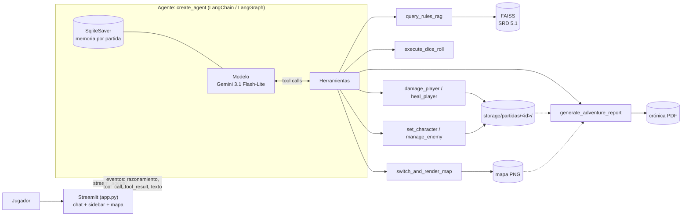

# Dungeon Master AI: agente de D&D 5e con LangChain

Trabajo Integrador de **Modelos de Lenguaje** (UTN FRM, 2026).

Un Dungeon Master virtual construido con un **agente de LangChain** (`create_agent`). Narra la aventura, consulta el reglamento oficial (SRD 5.1) con **RAG**, resuelve el azar con tiradas de dados reales, mantiene la vida del personaje en un estado persistente y dibuja el **mapa ilustrado del dungeon** (con niebla de guerra y la ruta recorrida). Al terminar la partida genera la **crónica de la aventura en PDF**: el producto final, que se puede descargar. La interfaz web muestra **en vivo** qué hace el agente: su razonamiento, cada herramienta con sus argumentos y el resultado, y la respuesta final.

## Qué resuelve

**Dominio:** dirigir una partida de rol de Dungeons & Dragons 5ª edición, con reglas reales y estado de juego consistente.

**Usuario:** un jugador (o un grupo) que quiere jugar sin un DM humano y sin que el modelo "invente" las reglas, las tiradas o la vida del personaje.

**Tarea de ejemplo (varios pasos, no resoluble con una sola llamada ni una sola tool):**

> *"Entro a la armería."*
>
> 1. El agente **revela la sala en el mapa**, fija la ubicación del jugador y lo vuelve a renderizar.
> 2. **Consulta el reglamento** (RAG) para obtener las estadísticas del enemigo que aparece y las cita.
> 3. **Registra al enemigo** en el combate (se ve en la barra lateral, con su recompensa de XP y oro).
> 4. **Tira los dados** del ataque contra la CA del jugador (y el daño si impacta).
> 5. **Aplica el daño** al estado real: baja la vida del jugador o la del enemigo. Si el enemigo cae, el jugador cobra su XP y oro (y puede subir de nivel).
> 6. Narra el resultado. Al terminar la aventura (*"Terminemos: genera la crónica"*), el agente **genera el PDF de la crónica**, con la ficha, el mapa con la ruta, la cronología y las reglas consultadas, listo para **descargar** (producto final tangible).

## Arquitectura



### Componentes y por qué están

| Componente | Qué es | Por qué |
|---|---|---|
| **Agente** | `create_agent` de LangChain (sin Deep Agents) | Resuelve el bucle modelo ↔ herramientas con tool calling. |
| **Modelo** | `gemini-3.1-flash-lite` (Google Gemini) | Soporta tool calling (verificado), tiene tier gratuito y devuelve resúmenes de razonamiento. |
| **Memoria** | `SqliteSaver` (checkpointer de LangGraph) en `storage/memoria.db`; el `thread_id` es el id de la partida | Permite turnos que dependen de los anteriores ("¿cuánto salió en esa tirada?") y **sobrevive a recargar la página y a reiniciar Streamlit**. Si un turno se corta a mitad de una tool, `reparar_hilo()` deja la conversación utilizable. |
| **RAG** | FAISS + embeddings `gemini-embedding-2` sobre 6 documentos del SRD | El modelo no memoriza las reglas con fidelidad; el RAG aporta hechizos, monstruos y reglas exactas. |
| **UI** | Streamlit | Permite chat con markdown y mostrar el flujo del agente en streaming (ver §3.5 de la consigna). |
| **Middleware** | **Ninguno** | Los reintentos ante errores 429/5xx los resuelve el cliente de Gemini (`max_retries=4` configurable con `GEMINI_MAX_RETRIES`: 1 pedido + 3 reintentos con esperas de ~1, 2 y 4 s, y un `timeout` de 30 s por intento configurable con `GEMINI_TIMEOUT`) y el tope de pasos se fija con `recursion_limit`. No hacía falta código ni middleware adicional. |

### Herramientas

| Tool | Tipo | Qué hace | Entradas → Salida |
|---|---|---|---|
| `query_rules_rag` | **Externa** (base vectorial) | Busca en el SRD hechizos, monstruos, condiciones, armas, armaduras y reglas. | `query: str`, `category: str` (`spells`, `monsters`, `conditions`, `armor`, `weapons`, `rules` o `general`) → fragmentos, cada uno con su documento de origen (`archivo.txt › Título`) y la línea `FUENTES CONSULTADAS` |
| `execute_dice_roll` | **Propia** | Ejecuta tiradas reales (`1d20+5`, `2d6`, `4d6kh3`) y compara con CA/CD. | `dice_formula`, `reason`, `target_dc_or_ac` → JSON con dados, total y éxito |
| `damage_player` / `heal_player` | **Propias** | Modifican la vida del jugador en el estado real (`storage/partidas/<id>/estado.json`). | `amount: int`, `source: str` → JSON con HP anterior y nuevo |
| `manage_enemy` | **Propia** | Lleva los enemigos del combate: `spawn` (con HP y recompensa), `damage` y `remove`. Al derrotar a uno, el jugador cobra su oro y XP automáticamente y puede subir de nivel. | `action`, `name`, `hp`, `amount`, `xp`, `gold` → JSON con el estado del enemigo y la recompensa |
| `set_character` | **Propia** | Guarda la ficha del personaje cuando el jugador termina de crearlo. | `name`, `race`, `char_class`, `level` → JSON con la ficha |
| `switch_and_render_map` | **Propia** + externa (archivo) | Mueve al jugador: revela salas (validadas contra el layout), fija su ubicación y renderiza el mapa con niebla de guerra. | `revealed_nodes: list[str]`, `current_room: str` → texto con salas nuevas, ubicación y PNG en la carpeta de la partida |
| `generate_adventure_report` | **Propia** + externa (genera un documento) | Genera la **crónica de la aventura en PDF** (ReportLab): portada, ficha, resumen, mapa con la ruta, balance de combate, cronología y reglas consultadas. Todos los datos salen del estado del juego; el modelo solo aporta el epílogo. | `summary: str` (epílogo de 3 a 6 frases) → JSON con la ruta del PDF, sus páginas y su tamaño |

**Partidas guardadas:** cada partida tiene un id y una carpeta `storage/partidas/<id>/` con `estado.json` (ficha, vida, oro, XP, enemigos, sala y ruta), `mensajes.json` (el chat visible), `mapa.png` e `informes/` (PDFs). La memoria del agente (`storage/memoria.db`) usa ese mismo id, así que las tres cosas van juntas. En el sidebar, **Nueva partida** crea otra y la pestaña **Historial** permite abrir o borrar las guardadas; al recargar la página se retoma la última. Si había un `storage/game_state.json` de versiones anteriores, se copia como primera partida.

**Estado del juego:** vive en `estado.json` de la partida activa y lo modifican solo las tools (ficha, vida, oro, XP, enemigos, sala actual y ruta, y un registro de eventos de la partida). Cada modificación es una **transacción atómica** bajo un lock: LangGraph puede ejecutar varias tools a la vez en un mismo turno y, sin esto, una pisaría los cambios de otra. En cada turno el agente recibe una línea `[ESTADO: ...]` con los datos reales, así no inventa ni usa valores viejos.

Todas manejan sus errores sin cortar el flujo (devuelven un mensaje/JSON de error que el agente puede leer).

## Estructura del repositorio

```
app.py                  # UI Streamlit: chat, streaming, sidebar (partidas, ficha, mapa)
agent/
  core.py               # create_agent, checkpointer, stream_agent() / run_agent()
  tools.py              # las 5 herramientas
  prompt.py             # system prompt del DM + reglas
game_engine/
  state_manager.py      # partidas guardadas y su estado (vida, oro, salas, enemigos)
  map_renderer.py       # layout del dungeon y mapa ilustrado con niebla de guerra (Pillow)
  report.py             # crónica de la aventura en PDF (ReportLab)
rag/
  data/*.txt            # corpus (6 documentos del SRD)
  retriever.py          # búsqueda en FAISS
setup_rag.py            # ingesta + chunking + embeddings + índice
assets/map/             # ilustraciones del mapa y del PDF: íconos de las salas, brújula, ficha, portada, pergamino y niebla (generadas por el equipo con IA)
storage/vector_db/      # índice FAISS ya construido (incluido en el repo)
storage/partidas/        # partidas guardadas: estado, chat, mapa y PDFs (no se versiona)
storage/memoria.db      # memoria del agente (SQLite, no se versiona)
.streamlit/config.toml  # tema de la UI
ui/style.css            # tipografía de lectura de la narración
ui/visor_mapa.py        # visor del mapa: entra en cualquier pantalla, zoom con la rueda, arrastre y descarga
```

## Instalación y ejecución

**Requisitos:** Python 3.11 o superior (es el mínimo que exigen las dependencias; el proyecto se probó con Python 3.14 en Windows 11) y una API key de Google Gemini.

### 1. Clonar y crear el entorno virtual

```bash
git clone https://github.com/facu-1538/Dnd-Agente-DM.git
cd Dnd-Agente-DM
python -m venv venv
```

Activarlo:

```bash
# Windows PowerShell
.\venv\Scripts\Activate.ps1
# Windows CMD
venv\Scripts\activate.bat
# Linux / macOS
source venv/bin/activate
```

### 2. Instalar dependencias

```bash
pip install -r requirements.txt
```

### 3. Configurar la API key

Obtené una clave gratis en <https://aistudio.google.com/app/apikey>, copiá el archivo de ejemplo y editalo:

```bash
# Windows
copy .env.example .env
# Linux / macOS
cp .env.example .env
```

En `.env` dejá la clave **sin comillas**:

```
GEMINI_API_KEY=tu_clave_real
```

`.env` está en `.gitignore`: no lo subas nunca. Variables opcionales (se agregan al mismo `.env`):

| Variable | Por defecto | Para qué |
|---|---|---|
| `GEMINI_MODEL` | `gemini-3.1-flash-lite` | Cambiar el modelo del agente (debe soportar tool calling). |
| `DM_INCLUDE_THOUGHTS` | `1` | Con `0` no se pide el razonamiento al modelo. |
| `GEMINI_MAX_RETRIES` | `4` | Intentos totales por llamada (incluye el original) ante 429/5xx/timeouts. |
| `GEMINI_TIMEOUT` | `30` | Segundos máximos por intento. Peor caso por llamada: intentos × timeout + esperas. |
| `GEMINI_THINKING_BUDGET` | `-1` | Tokens máximos de razonamiento (`-1` = dinámico, sin tope). Un valor fijo, por ejemplo `2048`, acota el pensamiento. |

### 4. Ejecutar

```bash
streamlit run app.py
```

Se abre en <http://localhost:8501>. El índice vectorial ya viene en el repositorio, así que **no hace falta ejecutar `setup_rag.py`** para jugar.

> Los tiers gratuitos tienen límite de peticiones. **La latencia de Gemini es muy variable.** Medimos el mismo turno de combate (impactar y derrotar a un goblin, 4 llamadas al modelo), una sola muestra por configuración: sin razonamiento (`DM_INCLUDE_THOUGHTS=0`) 7 s; con `GEMINI_THINKING_BUDGET=2048` 28 s; con `1024` 74 s; con `-1` (dinámico, el valor por defecto) 83 s. No es monótono, así que no pudimos aislar la causa; en una de las corridas una llamada tardó ~30 s, justo el `GEMINI_TIMEOUT`, y se reintentó. Un turno de 4 llamadas llegó a tardar 192 s antes de tener `timeout`. Para la demo conviene dejar respirar un minuto entre pruebas y, si la latencia molesta, usar `DM_INCLUDE_THOUGHTS=0` (turnos de pocos segundos, a costa de no mostrar el razonamiento). Si ves un error 429, esperá un minuto y reenviá el mensaje.

## Cómo demostrar cada requisito

| Requisito | Qué hacer en la UI |
|---|---|
| **Tarea de varios pasos** | Escribí `Un goblin me ataca en la armería.` y mirá la secuencia de herramientas. |
| **Visibilidad de tools (streaming)** | Cada herramienta aparece en la línea de tiempo apenas se invoca, con sus argumentos; al terminar muestra el resumen del resultado. Al abrirla se ve el resultado completo. |
| **Razonamiento** | Bloque "Razonamiento", diferenciado de la respuesta. Se muestra en vivo mientras el modelo piensa. |
| **Pasos abiertos** | El interruptor **Mostrar pasos abiertos** (sidebar, activo por defecto) despliega el razonamiento y cada herramienta; apagado, la vista es compacta. Cada paso muestra cuánto tardó y cada turno cierra con `N herramientas · X s`. |
| **Estado coherente** | Creá tu personaje (`Soy Aldric, humano guerrero`) y mirá cómo la sidebar muestra la ficha. Tras un combate se actualizan la vida, el oro, la XP, la ubicación y los enemigos. |
| **Memoria** | Después de una tirada preguntá `¿Cuánto salió en esa tirada?`: responde sin que se lo repitas. |
| **RAG y citas** | Preguntá `¿Qué hace el hechizo Bola de Fuego?`: aparece la consulta de reglas con sus **fuentes consultadas** (al abrir el paso), y la respuesta cita el documento, por ejemplo `(Fuente: spells.txt › Fireball)`. |
| **Producto tangible** | Escribí `Terminemos: genera la crónica de la aventura`. El agente llama a `generate_adventure_report` y aparece el botón **Descargar crónica (PDF)**. El mapa también se descarga como PNG (botón de la barra lateral y del chat); **Ampliar** lo muestra a tamaño completo. |

## RAG: corpus e ingesta (reproducible)

**Corpus:** 6 documentos de texto en `rag/data/`: `spells`, `monsters`, `conditions`, `weapons`, `armor` y `rules`. Provienen del SRD 5.1 de Wizards of the Coast a través de la API pública [Open5e](https://open5e.com/).

**Pipeline** (`setup_rag.py`):

1. **Ingesta:** descarga cada categoría de la API Open5e y la guarda como Markdown en `rag/data/*.txt`. Si esos archivos ya existen, se omite la descarga.
2. **Chunking:** primero por encabezados (`##`, una entrada por hechizo o monstruo) y luego `RecursiveCharacterTextSplitter` con `chunk_size=2000` y `chunk_overlap=200`.
3. **Embeddings:** `gemini-embedding-2` por lotes de 50, con pausas para respetar el límite por minuto.
4. **Índice:** FAISS local en `storage/vector_db/`. Cada fragmento guarda su `categoria` (= archivo de origen) y su `titulo`.

**Tamaño del contexto:** la tool devuelve como máximo 4 fragmentos de ≤2000 caracteres (~8000 caracteres), para no saturar el contexto del agente.

**Citas de las fuentes:** cada fragmento que recibe el agente lleva un encabezado con su documento de origen (`[Fuente 1: monsters.txt › Goblin]`) y la tool cierra con la línea `FUENTES CONSULTADAS`. El prompt del DM (`CITAS_RAG` en `agent/prompt.py`) le exige citar entre paréntesis, con ese mismo formato, todo dato de reglas que use, y no citar nada que no haya salido de la herramienta. La UI muestra la lista de fuentes al abrir el paso de la consulta. Como la búsqueda devuelve hasta 4 fragmentos, algunos pueden no ser relevantes: el modelo cita solo los que usa. Verificado con Gemini real tanto en una pregunta de reglas como en un turno de combate.

**Reconstruir desde cero:**

```bash
# Volver a descargar el corpus desde Open5e e indexar los fragmentos que falten
python setup_rag.py --force
```

Para regenerar el índice completo, borrá `storage/vector_db/` y ejecutá `python setup_rag.py`. El script indexa solo los fragmentos que todavía no están (los identifica por un hash de su contenido). El proceso tarda varios minutos y puede agotar la cuota diaria de embeddings: guarda el progreso y se reanuda al volver a ejecutarlo.

## Visibilidad del razonamiento

`gemini-3.1-flash-lite` solo devuelve razonamiento si se activa el pensamiento dinámico (`thinking_budget=-1`), que ya viene configurado en `agent/core.py`. Gemini entrega un **resumen** del razonamiento, **en inglés**, no la cadena de pensamiento completa. En turnos simples puede no emitir ningún bloque; en ese caso la UI no muestra nada.

## Limitaciones conocidas

- **Un solo jugador por servidor:** el estado de la partida es un singleton del proceso (una partida activa a la vez). Dos pestañas jugando partidas distintas al mismo tiempo se pisarían; está pensado para una sesión de juego.
- **Turno cortado:** si se cierra la página a mitad de un turno, al volver se agrega una nota del DM y el siguiente mensaje continúa con normalidad.
- **Dungeon fijo:** el mapa tiene 8 salas definidas en `game_engine/map_renderer.py`; el agente solo decide cuáles revelar.
- **Crónica en PDF:** el balance y la cronología se calculan sobre los últimos 300 sucesos del registro (la cronología del PDF muestra los últimos 150). El epílogo lo escribe el modelo y puede agregar color narrativo; los datos de la ficha, el mapa y las cifras salen del estado. Usa fuentes estándar de PDF, por lo que se omiten símbolos que no traen (flechas, emojis).
- **Ficha simplificada:** se guardan nombre, raza, clase y nivel. Los atributos no se guardan (el DM asigna la matriz estándar al crear el personaje) y la vida máxima es siempre 100.
- **Oro y XP:** solo se obtienen al derrotar enemigos; no hay botín en cofres.
- **Bienvenida fija:** es un texto estático (no gasta una llamada al modelo) que se registra en la memoria del agente.
- **Cuota gratuita:** los límites de Gemini pueden producir errores 429 o latencias altas (ver la nota de la sección de ejecución); los reintentos no ayudan si se agota la cuota diaria.
- **Idioma del razonamiento:** llega en inglés (resumen del proveedor).
- **Índice FAISS:** se carga con `allow_dangerous_deserialization=True` (formato pickle). Es seguro porque el índice lo generamos nosotros, pero no cargues índices de terceros.

## Problemas frecuentes

| Síntoma | Causa y solución |
|---|---|
| `GEMINI_API_KEY no configurada` | Falta `.env` o la variable. Copiá `.env.example` y completá la clave. |
| Error 429 / "quota" | Límite del tier gratuito. Esperá un minuto; si es la cuota diaria, probá más tarde. |
| El modelo no existe (404) | Cambiá `GEMINI_MODEL` por un modelo disponible para tu cuenta. |
| Falla al arrancar con el razonamiento | Poné `DM_INCLUDE_THOUGHTS=0` en `.env`. |
| `Activate.ps1` no se ejecuta | Usá CMD con `activate.bat`, o habilitá scripts en PowerShell. |
| El RAG no responde | Verificá que exista `storage/vector_db/` o regeneralo con `python setup_rag.py`. |

## Referencias

- [LangChain: agentes](https://docs.langchain.com/oss/python/langchain/agents)
- [LangGraph: persistencia (checkpointers)](https://docs.langchain.com/oss/python/langgraph/persistence)
- [Streamlit](https://docs.streamlit.io/)
- [Open5e API](https://open5e.com/) y System Reference Document 5.1 (Wizards of the Coast, licencia abierta OGL 1.0a / CC-BY-4.0)
- [Google AI Studio](https://aistudio.google.com/)

## Equipo

Integrantes: _(completar)_
